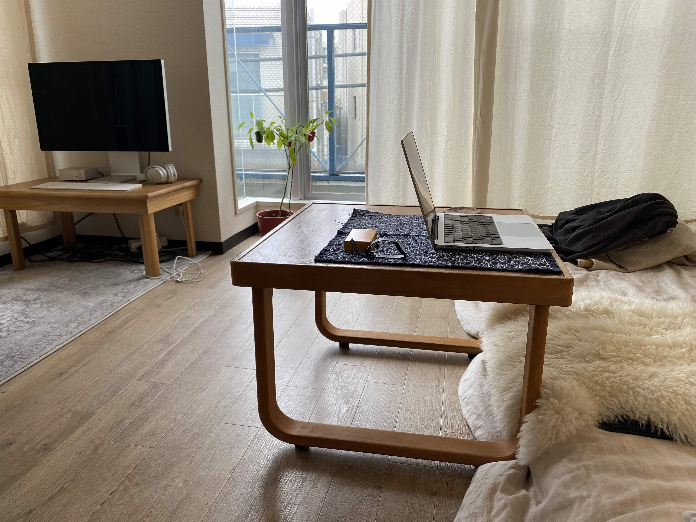
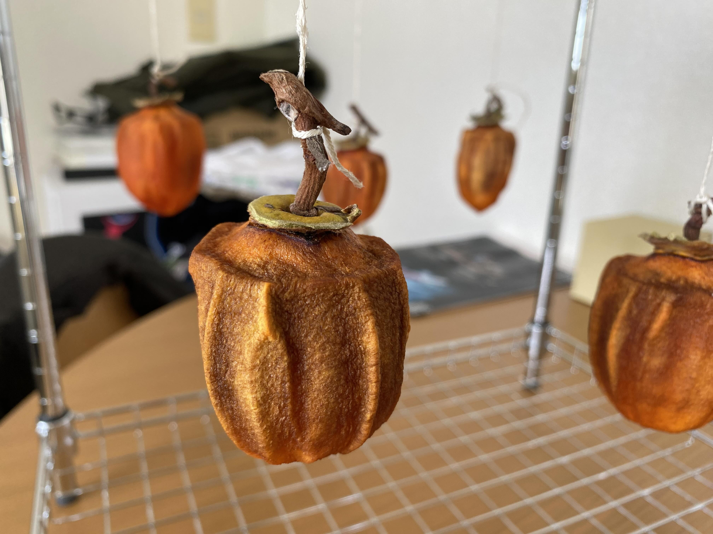

On the lower levels of the massive mall around which the Marina Bay Sands conference-and-expo-center is built, I walked by storefronts for every luxury brand I have ever heard of. Miu Miu had tableaux of chrome-plated trees garlanded in bric-à-brac. I overheard a man say to another man that he had always been thinking about getting a Burberry scarf.

I stopped at Le Labo, which there as in its other locations features a central, waist-high counter for the scents, as well as a porcelain basin in the corner at which lotions, soaps, and oils can be tested. The shopkeeps paid me no mind.

I read a tweet once where someone said some subway stop in NYC, when the doors opened, smelled like Santal 33. This is a Le Labo scent. They also mentioned some other perfume that had recently supplanted the Santal 33, mainly, it seemed, as a way to show they were above-it-all. Sophie once used the word 'gourmand' to describe a class of perfumes. Like how some people want to smell like donuts.

I sniffed their wares. I think one is supposed to use the small disposable paper strips for this, because the volatiles express in different ratios over time, but I didn't. I just uncapped and huffed the nozzles, like an animal. I think among the ones they had that I liked Ambrette 9, which is just musk and powder. The reviews on *fragrantica* express mostly indifference. A beginner's scent. Amateur. Intimate (which is a codeword for inoffensive). I've been told the Bushwickians prefer metallics these days------that they want to smell like Zinc in their thrashed mesh tabis.

I landed back in Tokyo in the late morning on Saturday the 22nd of November. Because of a sudden fierce rain the plane had lingered at the gate in Singapore long after we'd boarded. The verb we use to wait out a storm is 'weathering.' But we are always weathering. I felt lachrymally pretty raw after deplaning, maybe from the cabin altitude, or from however they violently condition the air. My trek back on the scenic monorail was smooth. Cool, early-winter air moved easily through the aboveground stations and dried me further. The last time I transited back from the airport a man across the train car from me had spilled almost his entire bottle of tea on the floor. I had fished a day-glo ダイソ rag from deep in my backpack and thrown it down to sop up what remained.

That same night (after Singapore) I stole out to the オオゼキ near me and bought two packs of three 渋柿 each, which I had seen for sale just before I left. The thought of them being pulled before I returned had spooked me; I'm not sure why. Maybe because I didn't manage last year. These are from 山梨県, which I imagine must be well-known for persimmons, or is at least where Sophie and I once bought a few good examples.

I also bought a modular metal rack from ダイソ on which to hang them------I had some twine saved from last year. I managed to peel and tie them　at around 10:00pm. And, perhaps to sublimate other more pressing worries, I waffled for a while over whether to buy a small fan like the one I had used during the critical first week of my Cambridge attempt. For now I've just kept my bathroom and kitchen windows open------they're on opposite sides of my apartment's second room and encourage a 'cross-draught.' It's been cold and dry this past week, and I allow myself to feel like my place is simply made for drying 渋柿. My only worry is the possibility of mold, though with the nights dropping into the lower forties this feels unfounded. I do not understand mold completely; I think even in the cold it can creep into protected niches. When I am in the kitchen I have been occasionally fanning the 渋柿, hung in pairs, inspecting their mattening surfaces, encouraging them to swing by matching my fanning speed to their pendular frequencies. In my Singaporean hotel room the shower was such a perfectly sealed rectangle of glass that I could induce a standing wave with my voice, feeling the peaks at each octave, how the resonance amplitude followed some Breit–Wignerian shape.

I've been trying to treat my face more carefully. I cleanse. I apply Weleda Skin Food Light afterwards, sometimes following a toner, and most recently as a final step an SPF oil-suppressing fluid from *La Roche Posay* that smells, for unknown reasons, faintly sweet. I have heard it's better to press emollient into the face, as opposed to rubbing it in. I ordered two small tins of Carmex online (a strong-smelling mentholish petroleum by-product), which last me about half a year each, and whose form factor (the tins, not the tubes) I insist upon entirely, I now realize, because my mother bought them for herself when we were children. Being driven home from school we'd be allowed to dip a finger in the tin and apply the slickness to our lips.

In proportion to stress and lethargy over applications I have been making spontaneous, albeit not especially reckless, purchases. The first is the second ちゃぶ台 on which I am writing this post (or a portion of it, now weeks old, and being edited now while prone on my bed): a squarish table supported by two U-shaped bent-wood legs, made in the 80s by a domestic brand called マルニ, which still exists. The top is veneered in teak, while a low lip of some type of Japanese birch goes around the edge, and makes the legs. The ちゃぶ台 was bought the Monday before traveling to Singapore, deep into the night. I had been browsing メルカリ idly for ちゃぶ台 because neither my first low table (now for my desktop) nor my kitchen table served well for extended writing, which for whatever reason is encouraged by my laptop's smaller screen, familiar ergonomics, and propensity to make me hunch.

There is a water stain on the table's top, though I had seen this in the メルカリ post, which also indicated the table was (understandably, given its age) ぐらつく.　When I am not using it I store it by my Muji shelves, where my CRT television can just fit underneath, producing a tight arrangement of warmly colored wooden furniture together with my 棚 and 座椅子 and 箪笥. It has become obvious that I rely too much on the total arrangement of my surroundings to find the calm to do work, but in meantime the mornings have been made level by these new surfaces and their relative geometries. I can let the cloudless sun bounce around my room, and the ちゃぶ台 is spacious enough for my small 1980s clock, a cup, my laptop, and any auxiliary books or stationary.

-fig My new ちゃぶ台: taller and more mobile than my old ちゃぶ台. fig-
{: .right-para }

My other purchases include a finely knit charcoal woolen mock-neck sweater from Nest Robe Confect (also used, from　メルカリ), as well as a pair of plant-dyed ~~草木染め.~~ キャピタル jeans from a local thrift store, which are a curious deep green, and which I allowed myself in part because of their low price and unused condition. More truthfully I bought them also to lend my afternoon walk around 下北 legitimacy, which is a poor precedent to establish. I can taste the daughter-product of this legitimacy, which is called guilt, as a faint alkaloidal bitterness. I also spent a few dollars on a first edition copy of *Sun and Steel*, which has a portrait of 三島 on the back in a loin-cloth holding a 日本刀, and a beautiful geometric figure embossed in gold on its black bookcloth. The thought of perhaps having to jettison a good amount of this stuff if I move somewhere else spooks me only if I sit still too long in a quiet room　without internet access. This feeling is anyway counterweighted by the stupidity of affecting to acquire nothing because one knows they'll lose it anyway. Still, I've been sloppier recently, I worry------I have to read the books I find, or else wear the clothes I pick up. My Anscombe guide to the Tractatus has been sitting neglected on my bedside shelf for months. Three days ago I bought a 1980s Patagonia underlayer in blue, and have been cycling it into my late evenings as the nights get colder. I sit on my fleece in the baselayer and my warm overshirt and write in the gloom with the cold air against my face. There is a scene in the *Mishima* movie where he writes bad plays by candlelight at a low table, and perhaps also neglects his wife.

On the 28th of November I climb 大山 in cloudless weather, forgetting to buy water before riding the funicular, and thus allowing myself to feel a little desiccated at the summit. I slip only once on the way down. These bursts of travel or activity seem to erupt in the fallow time between applications. I re-line a pocket of my black pants, which I have repaired twice before, in carefully made ichthyoid sashiko, spending an evening on it. I try to read 太宰 in the original. I massage the persimmons once they've dried for a week with my fingertips, adjusting the soft pulp inside of them.

I am not sure what I am waiting for. Everyone I know is living a strange distended life, though their responses to this 歪曲 vary between catatonia and convulsion. I think I care about attention, about getting more of the frequent low-stakes interactions with people that can lead toward cathectic confession. But my muscles for doing this get a little more dystrophic every day. I may be becoming weird in the way that no-one likes------that no-one *can* like------some unfetishizable disconnection from any common intimate language. I am needful and more than a little lazy, and this also gets in the way of banging out any of the serious calculations or reading that could eventually support the kind of easy competence that all of the bitter people in my profession ascribe to gifts of God. Fascination with the toil (or even the language of the toil) is most of the appeal. The discursiveness presses on ganglial knots that feel like mirth. But I speak to too few people, which then makes me want to compensate for their voices by splitting my mind, but people get very sick when they do this, so instead I seek out noisy places filled with people I don't know, or needless purchases. The people that do speak to me keep finding my writing, then saying nice things about it, then crying about it, or confessing, and it makes me feel that everyone is starving, because my writing is not that pleasant, and the reason they're starving might be something like the reason that I've been unable to write much of anything for months. I watch, sometimes, parts of the livestreams of a man who writes in his basement------the writing he shares is not very pleasant either, but I can feel something about the practical gorpishness of his dress, or the dusky half moons under his eyes, or his adamance that what he's doing can be done very seriously and very shamelessly. I can try to follow him into it, but I'm not sure how.

-fig 干している渋柿. fig-
{: .right-para }
